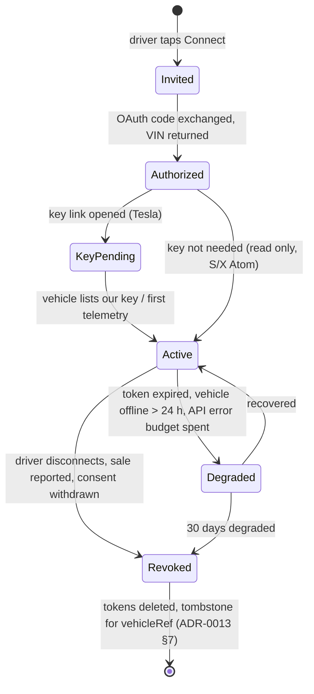

# Vehicle adapter design for the eMSP

**Status:** proposed · **Date:** 2026-10-28 · **Revision:** 0.1 · Implements [ADR-0019](adr/0019-vehicle-integration-and-digital-key.md). Pattern copied from ADR-0018 (hub adapters): ports, one anti-corruption layer per OEM, rules as pinned data, a conformance test.

Stack (ADR-0012 rev 0.3 and later): backend Java 25 on Spring Boot 4.x, Go where it already is (telemetry, planner), mobile React Native. The mobile app holds no OEM credential, partner key or token.

## 1. Where it sits

```
 React Native app ──(HTTPS, session of the driver)──▶ vehicle-gateway (Java) ──▶ OEM clouds
   │  link screens, SoC from Android Auto             │  ports, adapters, token vault
   │                                                  ├─▶ consent-decision (is `vehicle.read` granted?)
   │                                                  ├─▶ plugcharge (VehicleBinding evidence)
   │                                                  └─▶ Kafka: ev.vehicle.*  (pseudonymous only)
 tesla-edge (Go) ◀── Fleet Telemetry from vehicles ───┘ publishes SocObserved through the same sink
 planner (Go) ◀── HTTP: latest SoC per vehicleRef, or ev.vehicle.soc-observed.v1
```

`vehicle-gateway` is a new service in a new repository `EV_PNC_vehicle-gateway` (the user creates repositories; until then the code waits). `tesla-edge` is a small Go service because Tesla's reference Fleet Telemetry server and the command-signing proxy are Go; it is the only place that holds the Tesla command key.

## 2. Ports (module `vehicle-core`)

| Port | Direction | Purpose | Tesla | Togg | BYD |
|---|---|---|---|---|---|
| `VehicleLinkPort` | adapter offers | `startLink(driverRef)` returns an authorisation URL; `completeLink(code, state)` returns a verified `VehicleIdentity` (VIN, model, OEM) | OAuth code flow | not offered | not offered |
| `VehicleStatePort` | adapter offers | `latest(vehicleRef)` returns `SocReading{percent, chargingState, observedAt, source, confidence}` | REST read (cached) + telemetry | in-car source only | in-car source only |
| `VehicleStreamPort` | adapter offers | stream of readings into `SocSink` | Fleet Telemetry | no | no |
| `VehicleKeyPort` | adapter offers | `requestKey(vehicleRef)` returns the enrolment deep link; `keyStatus` | `https://tesla.com/_ak/<domain>` | **none** (guide only) | **none** (guide only) |
| `VehicleCommandPort` | adapter offers | charging commands | declared, **off** in v1 | no | no |
| `ConsentGate` | platform implements | `isGranted(driverRef, purpose)` for `vehicle.read` | uses consent-decision | | |
| `SocSink` | platform implements | publish `SocObserved`, store latest | | | |
| `TokenVault` | platform implements | store refresh tokens encrypted; no token leaves the service | | | |

`HubCapability` becomes `VehicleCapability`: `IDENTITY_VERIFIED`, `SOC_READ`, `SOC_STREAM`, `KEY_ENROL`, `COMMANDS_CHARGING`, `LOCATION`. An adapter declares only what is built; `/actuator/vehicle-capabilities` prints the matrix so the app can hide a button that has no backing.

| OEM | Declared in v1 | Source of truth |
|---|---|---|
| Tesla | `IDENTITY_VERIFIED`, `SOC_READ`, `SOC_STREAM`, `KEY_ENROL` | Fleet API (official) |
| Togg | none; `SOC_READ` only via the in-car source | VIN + registration document (P2-14) |
| BYD | none; `SOC_READ` only via the in-car source | VIN + registration document (P2-14) |

`LOCATION` is declared by no adapter in v1; the planner gets positions from the app (ADR-0013 §8).

## 3. Three evidence levels for the vehicle binding

`plugcharge` owns `VehicleBinding` (ADR-0007, state machine in `engineering-briefing/uml/10-state-binding.puml`). The binding gains an `evidence` attribute, never a VIN on the topic:

1. `user_entered`: VIN typed, plate from the registration document OCR (P2-14). Weakest.
2. `document_verified`: VIN read from the registration document and matched to the owner name (P2-14 acceptance criteria).
3. `oem_authorized`: the owner authorised our app at the OEM, the OEM returned that VIN for that account. Strongest, and cheap to check against level 2 (VIN must match). Only Tesla offers it in v1.

Policy (proposal): Plug&Charge eligibility (P0-08) and any loyalty benefit that depends on a verified vehicle need level 2 or 3. Level 3 alone never replaces the registration check for invoicing (P2-14, owner-only invoice).

## 4. Link state machine (`VehicleLink`, owned by `vehicle-gateway`)



Revocation within the 15-minute target of audit decision D4 (open); the adapter calls the OEM revoke endpoint where one exists and always deletes our token.

## 5. Tesla sequence (read only, v1)

```mermaid
sequenceDiagram
    participant App as React Native app
    participant VG as vehicle-gateway
    participant CD as consent-decision
    participant T as Tesla (auth + Fleet API EMEA)
    participant TA as Tesla app (owner)
    participant Car
    participant TE as tesla-edge (Go)
    App->>VG: POST /vehicle-links {oem: tesla}
    VG->>CD: isGranted(driver, vehicle.read)? (grant created in the app first)
    VG-->>App: authorisation URL (state + PKCE verifier kept server side)
    App->>T: system browser, owner signs in, approves scopes
    T-->>VG: redirect with code (HTTPS callback on our domain)
    VG->>T: exchange code (fleet-auth host)
    VG->>T: list vehicles, read VIN
    VG->>VG: match VIN with registration document (level 2 → 3)
    VG-->>App: open https://tesla.com/_ak/<our domain>
    App->>TA: deep link, owner approves our key
    TA->>Car: enrol public key
    VG->>TE: configure telemetry for VIN (SoC, charge state; no location)
    Car-->>TE: telemetry (mTLS)
    TE->>VG: SocObserved (vehicleRef resolved inside the service)
    VG->>Kafka: ev.vehicle.soc-observed.v1 (vehicleRef, percent, state, time)
```

Rules that fall out of the Tesla facts: register in the EMEA region and in no other; host the public key at the well-known path for the life of the service; never poll (use telemetry; a REST read only when a driver opens a plan and the last reading is older than 10 minutes, and wake the car only on that explicit user action, because a wake costs ten times a REST read); request `vehicle_device_data` only for v1; no `vehicle_location` scope.

## 6. Events (proposed rows for `tools/topics.csv`, owner `vehicle-gateway`; not added to the file)

| Topic | Key | Cleanup | Retention | Class | Payload (no VIN, plate, location) |
|---|---|---|---|---|---|
| `ev.vehicle.soc-observed.v1` | `vehicleRef` | delete | 7 d | C-volume, pseudonymous | `percent`, `chargingState`, `observedAt`, `source` (`oem_stream`, `oem_read`, `in_car`, `user_entered`), `confidence` |
| `ev.vehicle.link-changed.v1` | `vehicleRef` | compact | | B-state, pseudonymous | `oem`, `state`, `evidence`, `capabilities`, `changedAt`; consumers `plugcharge`, `planner`, `pilot-analytics`, `loyalty` |

Erasure follows ADR-0013 §7 (delete the mapping, tombstone `vehicleRef`). The checker `eventflow_check.py` must pass before the rows are merged.

## 7. Planner contract (planner is Go)

The planner reads `SocReading` as input to arrival-SoC and the "SOC drift" re-plan trigger (P3-03). Fields it must honour: `confidence`, `source` and age. Proposal: a reading older than 10 minutes while driving is marked stale and the planner falls back to its own energy model from the last good reading (`engineering-briefing/mobile-app/tb_energy_model.py` logic, card P3-01); a `user_entered` reading is accepted without a stale check for the first 5 minutes only. Tolerances are assumptions to confirm on the corridor test trips.

## 8. Mobile (React Native)

- Screens: *Connect your car* (Tesla: OAuth in the system browser, then the key approval hand-off), *My vehicle* (link state, evidence level, disconnect), *Digital key help* for Togg and BYD (explains that the key lives in Trumore / the BYD app / Wallet, links to the OEM app, no pairing by us).
- No tokens, keys or OEM secrets in the app or its storage; the app holds only the driver's own session.
- Android Auto SoC (card VH-06): a thin Java native module forwards the energy level when the projection reports it; CarPlay none.
- All copy in TR/EN/DE/NL with P3-05.

## 9. Testing without touching an OEM

Same rules as ADR-0018: `VehicleTransport` is a seam, adapters build requests as data, nothing opens a socket in unit tests; pinned fixtures per OEM under `contracts/`; a `VehicleAdapterContract` test class every adapter subclasses; a characterization test compares our parsed Tesla payloads with the pinned field list. The simulator (`EV_PNC_simulator`) gains a fake OEM cloud and a CCC Digital Key phase-1/2 test double (VH-08) so the app flows run end to end offline.

## 10. Failure semantics

`FailureClass` as in ADR-0018: retryable (HTTP 429/5xx), non-retryable (invalid scope, vehicle unsupported), configuration (domain key missing at the well-known path, wrong region), unknown state (command accepted, outcome not seen). A vehicle that is asleep is `OFFLINE`, not an error. When the API budget for a month is reached the adapter degrades to `user_entered` and raises an alert; it does not run unbounded.
