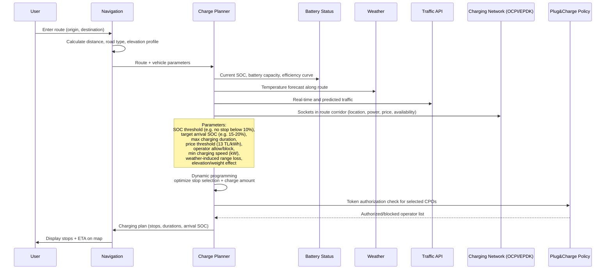

# Request for Proposal (RFP)

## EV Charging Infrastructure Integration and Mobile Navigation Platform

**OCPI 2.01/2.2 • ISO 15118 Plug & Charge • EPDK Integration**  
**Turkey-Focused Starting Document | October 2026**

---

## 1. Purpose and Scope

This RFP invites proposals for the development of an end-to-end electric vehicle (EV) charging experience platform targeting the Turkish market, with potential extension to Europe.

The platform shall deliver route planning, dynamic charging stop optimization, OCPI-based Charge Point Operator (CPO) integration, ISO 15118 Plug & Charge policy management, and one-time payment flows. The primary objective is to provide a membership-free, transparent, and reliable charging experience compliant with Turkish regulations (EPDK).

---

## 2. Project Overview

The system will offer an ABRP-like navigation experience with the following core capabilities:

- Cross-platform mobile application (iOS and Android preferred via single codebase) with CarPlay / Android Auto mirroring
- Integration with EPDK charging infrastructure data (location, status, pricing, availability)
- OCPI 2.01 and 2.2 compliant eMSP role (Locations, Sessions, CDRs, Tariffs, Token Authorization)
- Plug & Charge **Registration** and **Customization** menus (no “Start Plug & Charge” interaction)
- One-time credit card payment + explicit consent flow for unregistered users
- Dynamic charging planning incorporating SOC, weather, traffic, price thresholds, and operator policies

---

## 3. Functional Requirements

### 3.1 Mobile Application and CarPlay

The main application supports route plotting, charging stop recommendations, price and availability display, Plug & Charge policy settings, and payment confirmation. The CarPlay / Android Auto layer mirrors only navigation, charging status, and policy summary.

### 3.2 Plug & Charge Registration and Customization

**Critical Note:** There is no “Plug & Charge Start” interaction. Plug & Charge is automatic by nature. Instead, two dedicated menus are defined:

- **Registration**: ISO 15118 identity certificate creation, renewal, revocation, and management on the eMSP side.
- **Customization (Policies)**: User-defined rules, including:
  - Price threshold per kWh (e.g., filter out operators above 13 TL/kWh)
  - Operator-level allow / block lists
  - Minimum charging speed (kW)
  - Route corridor prioritization preferences

These policies are stored client-side and reflected server-side in the OCPI Token Authorization module. Tokens for expensive or blocked operators are never authorized.

### 3.3 Charging Planning and Optimization

When a route is entered, the system aggregates the following parameters and optimizes charging stops and energy amounts using dynamic programming:

- Current SOC, battery capacity, and efficiency curve
- Weather forecast along the route (temperature-induced range loss)
- Real-time and predicted traffic
- Socket location, power, price, and availability via EPDK / OCPI
- User policies (price threshold, operator preferences, minimum kW)
- Target arrival SOC, maximum charging duration, elevation, and weight effects

The planner uses incremental optimization. When availability or traffic changes en route, it recalculates using the previous plan as the starting point.

---

## 4. Technical Architecture (High-Level)

Recommended layers:

1. **Client Layer**: React Native or Flutter + separate CarPlay/Android Auto UI layer.
2. **API Gateway**: Rate limiting, JWT, CPO API key management.
3. **Core Services**: Routing engine (OSRM/GraphHopper), Charging Orchestration (OCPI Sessions), Telemetry (EPDK polling), Payment service.
4. **OCPI Adapter Layer**: Per-CPO adapters + 2.01/2.2 compatibility layer.
5. **Data Layer**: PostgreSQL, Redis, TimescaleDB (availability time series), object storage (CDR archive).
6. **Security**: KVKK explicit consent, card tokenization (PCI DSS), ISO 15118 certificate management, mTLS.
7. **Monitoring and Deployment**: Prometheus/Grafana, ELK, Kubernetes (Turkey region preferred for latency).

---

## 5. Charging Planning Sequence Diagram

The following diagram illustrates how the charging plan is generated after a route is entered. The planner combines battery state, weather, traffic, charging network data, and Plug & Charge policy through dynamic programming. Expensive or blocked operators never enter the candidate list.

---

## 6. Security, Privacy, and Compliance

- Explicit consent flow under KVKK (Turkish data protection law); card data is never stored, only tokens are retained.
- PCI DSS compliant payment integration (iyzico, PayTR, or equivalent).
- ISO 15118 Plug & Charge certificate chain management (eMSP side).
- mTLS for EPDK and CPO connections.
- Personal data minimization and access control in all logs.

---

## 7. Expected Deliverables

1. Detailed technical architecture and API specification
2. Working mobile application (iOS + Android) + CarPlay prototype
3. OCPI 2.2 eMSP implementation and at least 2 CPO adapters
4. EPDK telemetry integration and caching layer
5. Plug & Charge Registration & Customization modules
6. Payment and explicit consent flows
7. Monitoring, logging, and basic security documentation

---

## 8. Project Timeline (Indicative)

| Phase | Duration | Key Activities | Milestone |
|-------|----------|----------------|-----------|
| **Phase 1: Foundation** | Weeks 1–6 | Architecture finalization, EPDK integration, routing engine, core data model | Telemetry & basic route planning live |
| **Phase 2: OCPI & Charging** | Weeks 7–14 | OCPI 2.2 eMSP core, first 2 CPO adapters, Sessions/CDRs/Tariffs | End-to-end session start/stop with one CPO |
| **Phase 3: Plug & Charge & Policies** | Weeks 15–20 | ISO 15118 certificate management, Registration & Customization UI, Token Authorization filters | Price threshold & operator policies enforced |
| **Phase 4: Mobile & CarPlay** | Weeks 21–28 | Full mobile app, CarPlay/Android Auto mirroring, one-time payment + consent | Beta release (iOS + Android) |
| **Phase 5: Hardening & Launch** | Weeks 29–36 | Monitoring, security audit, load testing, additional CPO adapters, documentation | Production launch (Turkey) |

*Note: Timeline is indicative and subject to refinement based on selected vendor capacity and CPO readiness.*

---

## 9. Proposal Evaluation Criteria

| Criterion | Weight |
|-----------|--------|
| Technical competence and OCPI / ISO 15118 experience | 35% |
| Architectural approach and scalability | 25% |
| Cost and schedule | 20% |
| References and team structure | 15% |
| Local (Turkey) compliance and support | 5% |

---

*This document is an initial RFP prepared from prior technical discussions. Details will be refined during the proposal process.*

**— End of Document —**
