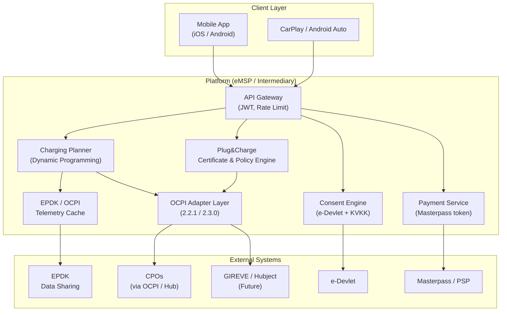
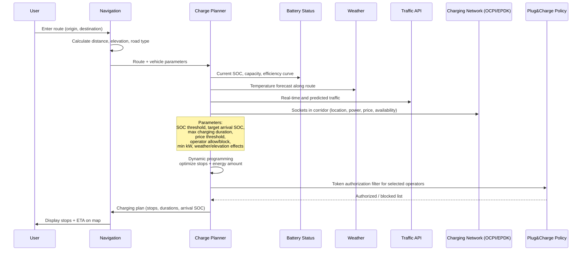
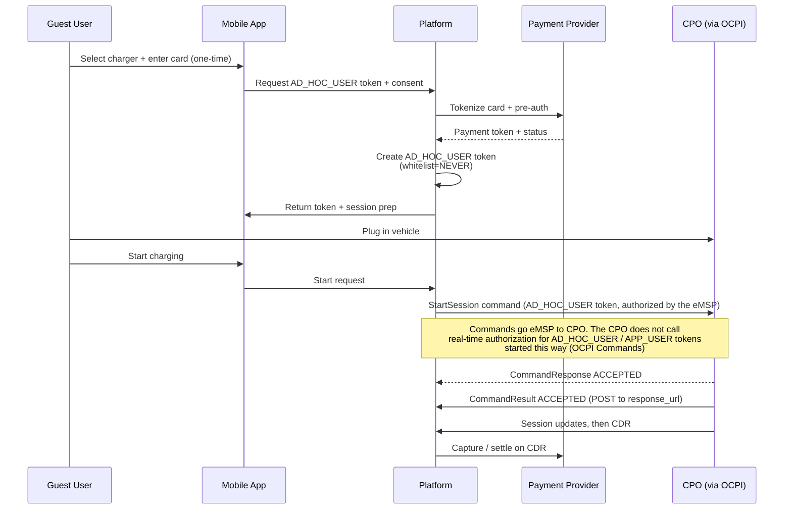

# Request for Proposal (RFP)

## End-to-End EV Charging, Navigation & Payment Platform  
**Turkey-First with European Roaming Readiness**

**Document Type:** Request for Proposal  
**Date:** 24 October 2026  
**Version:** 2.1 (corrections to 2.0, see [CHANGES](CHANGES.md))  
**Prepared for:** New Venture – EV Charging Infrastructure & Payment Integration (Turkey & Europe)  
**Based on:** Consolidated technical discussions, prior RFP drafts, and OCPI/AFIR market analysis  

---

## 1. Introduction and Background

This RFP seeks proposals for the design, development, and initial operation of a **neutral intermediary platform** that unifies electric vehicle (EV) charging infrastructure, intelligent navigation, and payment systems, starting in Turkey and prepared for seamless expansion into Europe.

The platform will **not** operate as a Charge Point Operator (CPO) or as a licensed payment institution. It will act as an eMSP (e-Mobility Service Provider) / integration layer that connects existing CPOs, payment providers, regulatory data sources, and drivers.

### Core User Promise
> The driver plugs in the vehicle and charging starts automatically. Payment is authorized end-to-end without cards, app memberships, or manual interactions. For guests, a one-time credit card + explicit consent flow is sufficient.

### Market Context
- **Turkey:** Fragmented charging experience (multiple apps, cards, pricing). Growing EV adoption. Opportunity to leverage e-Devlet (with explicit consent) for vehicle ownership data and Masterpass for payments. Strong pilot potential in high-season tourist corridors (e.g., Didim / Aegean).
- **Europe:** AFIR regulation drives ad-hoc payment requirements. Major roaming hubs (GIREVE, Hubject, e-clearing.net) now support or are moving to OCPI. ISO 15118 Plug&Charge is becoming table stakes.

---

## 2. Project Objectives

| Objective | Description | Priority |
|-----------|-------------|----------|
| Seamless Plug&Charge | Automatic session start and payment authorization via ISO 15118 | Must |
| Intelligent Navigation | ABRP-style route planning with dynamic charging stop optimization | Must |
| Neutral Intermediary | Connect CPOs and payment providers without becoming either | Must |
| Turkey-First Compliance | e-Devlet consent, Masterpass, EPDK data, KVKK | Must |
| Guest / Ad-hoc Experience | One-time credit card + explicit consent using OCPI AD_HOC_USER | Must |
| Policy-Driven Filtering | Client-side policies (price threshold, operator allow/block) enforced in Token Authorization | Must |
| European Readiness | OCPI 2.3.0 path, GIREVE/Hubject onboarding, AFIR alignment | Should |
| Pilot Validation | Technical + commercial proof in Didim seasonal market | Must |

---

## 3. Scope of Work

### 3.1 In Scope
- Mobile application (iOS & Android) with full CarPlay and Android Auto support
- OCPI 2.2.1 / 2.3.0 communication layer (eMSP role)
- ISO 15118-2 / 15118-20 Plug&Charge (certificate management, real-time authorization of EMAID tokens)
- Plug&Charge **Registration** and **Customization (Policies)** menus
- One-time credit card + explicit consent flow for unregistered users (AD_HOC_USER)
- Dynamic charging planner (dynamic programming) incorporating SOC, weather, traffic, price, policies, EPDK/OCPI data
- e-Devlet consent management and token-based vehicle ownership retrieval
- Masterpass (or equivalent) payment request integration
- EPDK real-time / near-real-time socket telemetry
- KVKK-compliant consent management system
- Pilot readiness for Didim / Aegean tourist corridor
- Architecture prepared for GIREVE and Hubject hub onboarding

### 3.2 Out of Scope
- Operating or owning charging stations (CPO role)
- Acting as a payment institution or holding funds
- Direct plate-to-identity matching without user-initiated consent token
- Building proprietary charging hardware
- Full OCPP CSMS development (adapters only if required)

---

## 4. Functional Requirements

| ID | Requirement | Priority | Notes |
|----|-------------|----------|-------|
| FR-01 | Automatic charging start upon plug-in (Plug&Charge) | Must | No “Start Plug&Charge” button |
| FR-02 | End-to-end autonomous payment authorization | Must | Registered users via stored method; guests via AD_HOC_USER |
| FR-03 | Single-time e-Devlet consent flow | Must | Token-based, granular, revocable |
| FR-04 | Masterpass (or equivalent) consent for charging payments | Must | Separate from general card storage |
| FR-05 | CarPlay / Android Auto navigation with socket overlay | Must | Real-time or near-real-time availability |
| FR-06 | Dynamic programming charging planner | Must | SOC, weather, traffic, price, policies, elevation |
| FR-07 | Policy management (price threshold, operator allow/block, min kW) | Must | Client-side + enforced in OCPI Token Authorization |
| FR-08 | Multi-CPO session support via OCPI | Must | Locations, Sessions, CDRs, Tariffs, Tokens |
| FR-09 | Guest one-time payment + explicit consent | Must | Credit card tokenization + KVKK consent |
| FR-10 | User dashboard (consent status, history, revocation) | Must | Transparency |
| FR-11 | Invoice / receipt generation | Should | Using e-Devlet-derived or session data |
| FR-12 | Support for foreign vehicles / EU roaming | Should | EMAID + hub readiness |
| FR-13 | Incremental re-planning when conditions change | Should | Previous plan as starting point |

---

## 5. Technical Requirements

| Area | Requirement | Standard / Technology |
|------|-------------|-----------------------|
| Roaming Protocol | CPO ↔ Platform | OCPI 2.2.1 (core) with clear upgrade path to **OCPI 2.3.0** (Parking objects for AFIR reporting, EMAID token type; the Payments module belongs to payment terminal providers, see below) |
| Vehicle Communication | Plug&Charge | ISO 15118-2 / 15118-20 |
| Token Types | Authorization | RFID, APP_USER, **AD_HOC_USER**, **EMAID** (EMAID is not pushed; the CPO authorizes it in real time) |
| In-vehicle UI | Navigation + status | Apple CarPlay + Android Auto |
| Identity & Consent | Vehicle ownership | e-Devlet consent token |
| Payment | Authorization request | Masterpass / Mastercard (or iyzico/PayTR equivalent) – PCI DSS, no card data stored |
| Telemetry | Socket data | EPDK official data sharing / API |
| Privacy | Data minimization | KVKK (Law 6698) + explicit granular consent |
| Backend | Scalability & security | Cloud-native, API-first, mTLS, Kubernetes (Turkey region preferred) |
| Future Europe | Hub connectivity | GIREVE IOP, Hubject OCPI support, e-clearing.net |

**Key OCPI Notes (from specification):**
- For `AD_HOC_USER` and `APP_USER` tokens: set `whitelist = NEVER`. CPO shall not perform real-time authorization at the eMSP for these token types when used via Commands (StartSession / ReserveNow).
- EMAID tokens are used for ISO 15118; certificate management is outside OCPI core. The eMSP should **not** push EMAID tokens: the CPO learns the issuing party from the charge point and calls the eMSP's real-time authorization endpoint (`POST /tokens/{uid}/authorize`), so the platform must implement that endpoint and answer quickly.
- `StartSession` and `ReserveNow` are Commands sent **from the eMSP to the CPO**. The eMSP authorizes the token before sending the command, so the CPO does not call real-time authorization for `AD_HOC_USER` / `APP_USER` tokens started this way.
- OCPI 2.3.0 adds Parking objects (the data AFIR requires CPOs to report to national access points) and the Payments module for payment terminals. The Payments module's data owner is the Payment Terminal Provider (PTP): it is exchanged between PTP and CPO, and the eMSP is not a party to it. TokenType is an OpenEnum that includes EMAID.
- OCPI 2.3.0 has **no Bookings module**. Reservations use the `ReserveNow` and `CancelReservation` commands. Any booking feature beyond that is a proprietary extension and must be marked as such.

---

## 6. High-Level Architecture

### 6.1 Charging Planning Sequence

### 6.2 Guest / Ad-hoc Payment Flow (AD_HOC_USER)

---

## 7. Phased Approach

| Phase | Duration | Key Activities | Key Deliverables | Milestone |
|-------|----------|----------------|------------------|-----------|
| **Phase 0 – Discovery & Design** | 4–6 weeks | Architecture, consent flows, partner mapping (CPO + PSP), legal/KVKK review, EPDK access path, OCPI version strategy | Architecture document, data flow diagrams, consent UX, partner shortlist, updated RFP | Architecture signed off |
| **Phase 1 – Core Backend & Turkey Integrations** | 10–12 weeks | OCPI 2.2.1 eMSP core (Locations, Sessions, CDRs, Tariffs, Tokens), EPDK telemetry cache, basic routing engine, consent engine skeleton | Working OCPI adapter, EPDK integration, API gateway, core data model | End-to-end session start/stop with 1 CPO |
| **Phase 2 – Plug&Charge, Policies & Guest Payments** | 8–10 weeks | ISO 15118 certificate management (Registration), Policy engine + Token Authorization filters, AD_HOC_USER flow + Masterpass, KVKK consent texts | Plug&Charge Registration/Customization modules, guest payment flow, policy enforcement | Price threshold & operator policies live |
| **Phase 3 – Mobile App, CarPlay & Planner** | 12–14 weeks | Full mobile app (iOS/Android), CarPlay/Android Auto mirroring, dynamic programming planner, incremental re-planning | MVP app + CarPlay prototype, working planner | Beta release (Turkey) |
| **Phase 4 – Didim Pilot** | 8–10 weeks | Partner onboarding (local CPOs), security & KVKK audit, limited live deployment, metrics collection, user feedback | Pilot-ready system, compliance report, pilot results report | Pilot completed with commercial signal |
| **Phase 5 – European Readiness & Scale** | 10–12 weeks | OCPI 2.3.0 upgrade (Parking objects and AFIR fields), GIREVE eMSP onboarding (IOP QA + certification), Hubject OCPI path, additional CPO adapters | GIREVE certified connection, AFIR-aligned data fields, scale roadmap | Europe roaming capability demonstrated |
| **Phase 6 – Hardening & Launch** | 6–8 weeks | Load testing, monitoring (Prometheus/Grafana), security audit, documentation, production launch | Production system, operational runbook, monitoring dashboards | Public launch (Turkey) + Europe path |

**Total estimated duration to Turkey launch + Europe readiness:** ~14–16 months (indicative).

---

## 8. Deliverables Summary

1. Technical architecture & data flow diagrams (Phase 0)
2. OCPI 2.2.1/2.3.0 eMSP implementation + at least 2 CPO adapters (Phase 1–2)
3. EPDK telemetry integration and caching layer (Phase 1)
4. Plug&Charge Registration & Customization modules (Phase 2)
5. Guest AD_HOC_USER + explicit consent + payment integration (Phase 2)
6. Mobile application (iOS + Android) + CarPlay/Android Auto (Phase 3)
7. Dynamic charging planner (Phase 3)
8. KVKK compliance documentation & audit report (Phase 4)
9. Pilot deployment package & results report (Phase 4)
10. GIREVE/Hubject onboarding package & European readiness roadmap (Phase 5)
11. Monitoring, logging, and operational runbook (Phase 6)

---

## 9. Security, Privacy, and Compliance

- Explicit, granular consent under KVKK; card data never stored (tokenization only).
- PCI DSS compliant payment integration.
- ISO 15118 certificate chain management on eMSP side (HSM/TPM preferred).
- mTLS for EPDK, CPO, and hub connections.
- Personal data minimization; access control and audit logging.
- Preparation for AFIR Article 5 (ad-hoc payment) and Article 20 (data reporting) via the AD_HOC_USER flow and OCPI 2.3.0 Parking fields.

---

## 10. Open Issues & Risks

| Issue | Description | Mitigation Suggestion |
|-------|-------------|-----------------------|
| OCPI roaming maturity in Turkey | Limited mature roaming agreements | Start with direct CPO integrations; OCPI abstraction layer from day one |
| e-Devlet consent mechanics | Exact token lifetime, available data fields, revocation | Early legal + technical workshop with authorities |
| EPDK data access | API availability, rate limits, data quality | Phase 0 workshop; caching and fallback strategy |
| CarPlay navigation depth | Level of control over decision trees | Define minimal viable overlay first; iterate |
| Seasonality (Didim) | Winter demand drop | Design pricing and partnership models accordingly |
| Partner dependency | Need cooperative CPOs and PSP | Early LOIs in Phase 0 |
| OCPI version fragmentation | 2.1.1 still used by some hubs | Abstract OCPI layer; prioritize 2.2.1 → 2.3.0 |
| AFIR 2027 deadline | Payment terminal requirements on ≥50 kW TEN-T | The platform's ad-hoc path is the app and AD_HOC_USER flow. Card terminals at the charge point are a CPO and payment-terminal-provider matter (OCPI Payments module, data owner PTP); the platform does not own that module |

---

## 11. Proposal Submission Guidelines

Respondents are requested to include:

- Understanding of the intermediary / eMSP model and Turkey-specific constraints (e-Devlet, Masterpass, KVKK, EPDK)
- Proposed technical architecture (with diagrams) aligned with the phased approach above
- Approach to OCPI 2.2.1 → 2.3.0 migration and GIREVE/Hubject onboarding
- Approach to ISO 15118 certificate management and AD_HOC_USER guest flow
- Timeline and resource plan aligned with the phases
- Relevant experience with OCPI, ISO 15118, CarPlay, Turkish payment systems, or European roaming hubs
- Compliance and security approach (KVKK, PCI-related considerations)
- Estimated effort and commercial model (fixed, T&M, or hybrid)
- Team structure and local (Turkey) support capability

---

## 12. Evaluation Criteria

| Criterion | Weight |
|-----------|--------|
| Technical competence (OCPI, ISO 15118, navigation/planner) | 30% |
| Architectural approach, scalability, and Europe readiness | 25% |
| Cost and schedule realism | 20% |
| Relevant references and team structure | 15% |
| Local (Turkey) compliance, support, and partner network | 10% |

---

**Note:** This is a consolidated RFP derived from project discussion history, prior draft RFPs, and current market analysis (OCPI 2.3.0, AFIR, GIREVE/Hubject status as of October 2026). It should be reviewed and refined with legal, technical, and commercial stakeholders before formal issuance.

---

*End of Document*
